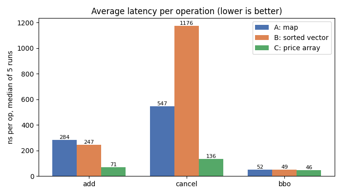
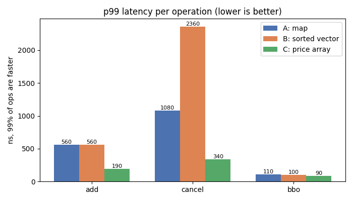
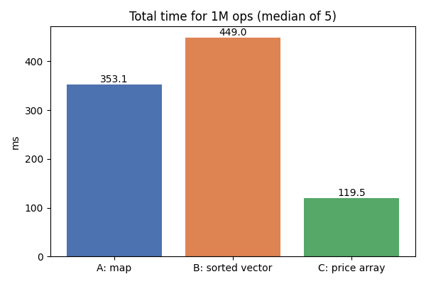
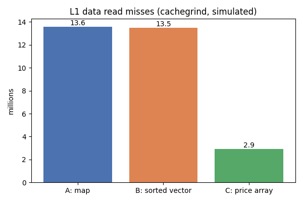
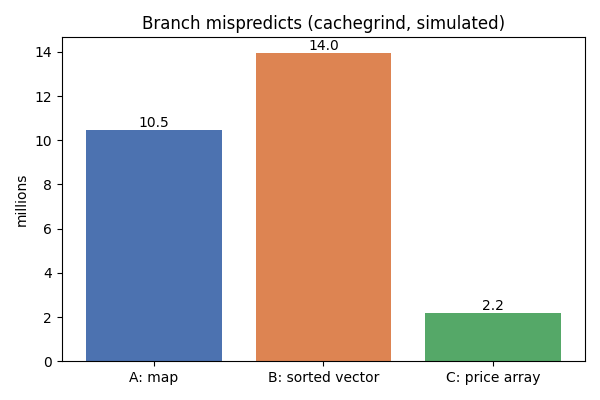
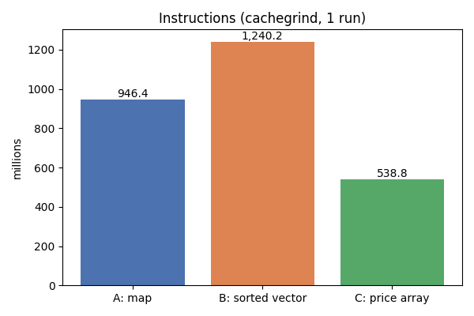
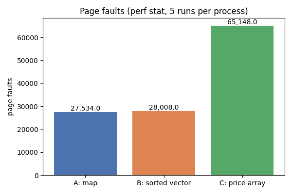

# Order book report

## Setup
- laptop: Intel i5-12500H (48 KB L1d, 1.25-2 MB L2, 18 MB L3), Windows 11, plugged in to the charger
- WSL2 with Ubuntu 24.04, kernel 6.6.87.2-microsoft-standard-WSL2, 8 GB RAM given to WSL
- g++ 13.3.0, `g++ -std=c++17 -O2 -g -fno-omit-frame-pointer bench.cpp -o bench`
- perf 6.8.12, valgrind 3.22 (cachegrind)

On battery the same benchmark ran 40-60% slower (Windows lowers the CPU speed to save power), so every number here
was measured on charger in one sitting.

### About the missing hardware counters
WSL2 does not pass my CPU's performance counters through to Linux. `dmesg` says
`unsupported p6 CPU model 154 no PMU driver, software events only`.
So in `perf stat` these all show `<not supported>`:
`cycles, instructions, branches, branch-misses, cache-misses, L1-dcache-load-misses, dTLB-load-misses`.
Only `task-clock` and `page-faults` work, which also means **IPC can't be calculated** on this machine.

To still have numbers for cache and branches I ran valgrind's cachegrind with `--cache-sim=yes --branch-sim=yes`.
It **simulates** a cache with my CPU's sizes (48 KB L1d, 18 MB last level) and a simple branch predictor.
These aren't real hardware counts, but they're exact, repeatable and fine for comparing the three books.
dTLB misses are not available at all.

The cachegrind numbers cover the whole program with `--runs 1`. That includes building the workload, which is the same for
all three (`make_workload`: 19.6 M instructions, 195 K L1 misses, 831 K mispredicts).


## Results table

| Metric | A (map) | B (sorted vector) | C (price array) |
|---|---|---|---|
| Total time (ms, median of 5) | 353.1 | 449.0 | **119.5** |
| ns / add | 283.6 | 246.6 | **71.1** |
| ns / cancel | 547.2 | 1175.9 | **136.2** |
| ns / BBO | 52.1 | 49.1 | **45.5** |
| p99 add / cancel / BBO (ns) | 560 / 1080 / 110 | 560 / 2360 / 100 | **190 / 340 / 90** |
| IPC | not supported in WSL2 | not supported in WSL2 | not supported in WSL2 |
| Instructions (cachegrind) | 946.4 M | 1,240.2 M * | **538.8 M** |
| Branch misses (%) (cachegrind) | 7.8% (10.48 M of 134.9 M) | 5.7% (13.96 M of 245.8 M) * | **4.5%** (2.19 M of 49.1 M) |
| L1-dcache-load-misses (cachegrind D1 read misses) | 13.58 M | 13.49 M | **2.92 M** |
| Cache misses (cachegrind last level misses) | 4.04 M | 3.72 M | **3.32 M** |
| dTLB-load-misses | not supported | not supported | not supported |
| Page faults (perf stat, 5 runs per process) | 27,534 | 28,008 | 65,148 |
| task-clock (perf stat, mean of 5) | 1,984 ms | 2,187 ms | **637 ms** |

\* about 80 M of B's branches and 110 M of its instructions are inside `memcpy`. Valgrind counts every step of the
`rep movsb` copy instruction as an instruction and a branch, and those are almost never mispredicted (88 K). Without them
B has ~166 M branches and an 8.4% miss rate (A 7.9%, C 4.8%).

Two notes on the timings:
- An empty timed block (two `steady_clock::now()` calls) costs about **24 ns** in WSL2. I measured that separately, and it's
  inside every per-op number above.
- p99 means 99% of ops were faster than this. It's counted in 10 ns buckets (a small histogram), so it's rounded up to the next 10 ns.


## Graphs
Made with `python plot_results.py`, which reads the files in `results/`.










## Raw output

### perf stat
`perf stat -r 5 -e task-clock,cycles,instructions,branches,branch-misses,cache-misses,L1-dcache-load-misses,dTLB-load-misses,page-faults ./bench --impl X`

A
```
 Performance counter stats for './bench --impl A' (5 runs):

           1983.73 msec task-clock:u                     #    0.934 CPUs utilized               ( +-  2.90% )
   <not supported>      cycles:u
   <not supported>      instructions:u
   <not supported>      branches:u
   <not supported>      branch-misses:u
   <not supported>      cache-misses:u
   <not supported>      L1-dcache-load-misses:u
   <not supported>      dTLB-load-misses:u
             27534      page-faults:u                    #   13.880 K/sec                       ( +-  0.00% )

            2.1238 +- 0.0640 seconds time elapsed  ( +-  3.02% )
```

B
```
 Performance counter stats for './bench --impl B' (5 runs):

           2187.46 msec task-clock:u                     #    0.944 CPUs utilized               ( +-  0.94% )
   <not supported>      cycles:u
   <not supported>      instructions:u
   <not supported>      branches:u
   <not supported>      branch-misses:u
   <not supported>      cache-misses:u
   <not supported>      L1-dcache-load-misses:u
   <not supported>      dTLB-load-misses:u
             28008      page-faults:u                    #   12.804 K/sec                       ( +-  0.00% )

            2.3165 +- 0.0237 seconds time elapsed  ( +-  1.02% )
```

C
```
 Performance counter stats for './bench --impl C' (5 runs):

            637.31 msec task-clock:u                     #    0.936 CPUs utilized               ( +-  2.01% )
   <not supported>      cycles:u
   <not supported>      instructions:u
   <not supported>      branches:u
   <not supported>      branch-misses:u
   <not supported>      cache-misses:u
   <not supported>      L1-dcache-load-misses:u
   <not supported>      dTLB-load-misses:u
             65148      page-faults:u                    #  102.223 K/sec                       ( +-  0.00% )

            0.6812 +- 0.0134 seconds time elapsed  ( +-  1.97% )
```

### perf record -g / perf report
The full output is in `results/perf_report_X.txt`. These are the top symbols by self time (long template names left out):

| A | | B | | C | |
|---|---|---|---|---|---|
| run_once (add_order + level map inlined) | 36.2% | cancel_order | 35.3% | clock_gettime (the timer) | 40.2% |
| cancel_order | 20.2% | add_order | 24.2% | run_once (whole book inlined) | 37.1% |
| clock_gettime (the timer) | 11.8% | clock_gettime (the timer) | 9.9% | make_workload | 4.1% |
| malloc / free internals | 10.6% | malloc / free internals | 8.1% | memmove | 3.4% |
| unordered_map rehash | 6.3% | rb-tree rebalance on erase | 6.4% | steady_clock::now | 2.5% |
| unordered_map operator[] | 4.7% | rb-tree destroy at end of run | 4.2% | llround (double -> tick) | 2.0% |
| unordered_map erase | 3.7% | rb-tree insert rebalance | 1.8% | vector growth (resize) | 2.0% |

### cachegrind
Summaries are in `results/cachegrind_X.txt`, and the per-function breakdown is in `results/cachegrind_functions_X.txt`.


## Analysis

### 11.1 Which implementation is fastest?
**C is the fastest for add, cancel and BBO.** It's about 4x faster than A on add and cancel, and about 3x faster over the whole run.

For BBO all three are close (45-52 ns), because BBO is O(1) in all of them and the ~24 ns timer is about half of that number.
perf shows the same thing: in C, **40% of all samples are inside `clock_gettime`**. C's book work is so small that reading the
clock is the most expensive thing in the loop.

Why C wins:
- **add** in C is one write into the orders vector, one `+=` into `qty_at_[tick]` and one compare against the best price.
  There's no malloc, no hashing and no tree walk. A's add hashes the id, sometimes rehashes the whole table (6.3% of A's time
  is `_M_rehash`, because the table grows from empty to 500 K orders), mallocs a node, and then walks a red-black tree of
  5000 levels (~13 nodes deep) to find the price.
  B's add is a bit faster than A's because its `std::map` of ids always inserts at the far right (ids only go up), so that path
  stays in cache, and its binary search runs over one contiguous array.
- **cancel** in C is `orders_[id]`, one memory read (usually a miss because the id is random), and then `qty_at_[tick]`, which is in
  a 120 KB array that stays in L2. A needs a bucket read, a node read, the level-tree walk and a free.
  B is the slowest by far: finding a random id in a `std::map` of ~500 K orders is ~19 pointer hops to random places on the heap.
  Cachegrind puts **2.54 M L1 misses on that lookup alone**, plus the rebalance on erase (6.4% in perf).

The p99 numbers tell the same story, but more strongly. C's slowest 1% of cancels finish under 340 ns, while B's take up to 2.4 µs.

### 11.2 Branch prediction
**B has the most branch mispredicts (13.96 M), and C has the fewest (2.19 M, 4.5%).** On the raw numbers A has the highest
miss rate (7.8%). Take the fake `memcpy` branches out of B's count, though, and B is the worst on rate too (8.4% vs 7.9%).

- **B**: my binary search does `if (levels[mid].tick < tick)` about 13 times per search. For a random price every one of those is
  basically a coin flip, so the CPU guesses wrong about half the time. Cachegrind puts 5.07 M mispredicts on `add_order`
  (the binary search), 1.45 M more on `cancel_order`, and 2.0 M on the id tree search in cancel.
- **A**: the same problem happens inside `std::map`. Going left or right at each tree node depends on a random price, so it's also a
  coin flip. 6.56 M of A's 9.58 M conditional mispredicts are in `stl_tree.h`.
- **C** doesn't search at all. Its branches are things like "is this the new best bid?", and once the book fills up the answer
  is almost always no, so the predictor learns it. The rescan loop almost never runs in this workload. Most of C's mispredicts
  aren't even in the book: 831 K are in `make_workload` and 512 K come from picking add/cancel/bbo at random in the bench loop.
  Both of those are the same for all three books. Only ~409 K are in `book_c.hpp`.

### 11.3 Cache behavior
**A and B have about 4.6x more L1 misses than C (13.6 M / 13.5 M vs 2.9 M).**
Last-level misses are close for all three (3.3-4.0 M). Most of those come from writing and then streaming through the 40 MB list of ops,
which is bigger than L3 and the same for everyone.

- **A follows pointers and allocates lots of small objects.** Every price level is its own tree node and every order is its own
  hash node, all malloc'd one at a time and spread around the heap. The level tree has 10,000 nodes (around half a MB), which doesn't
  fit in the 48 KB L1, so walking it misses L1 at most hops. It does fit in L2/L3, so those misses are cheap-ish
  (7.26 M L1 misses in the tree code, only 8 K went to RAM). malloc's own bookkeeping (`malloc_consolidate`, `unlink_chunk`) adds more.
- **B is half and half.** The levels are contiguous, so the binary search runs over an 80 KB array, which is nice. But the orders are in a
  `std::map` with ~500 K nodes, around 32 MB scattered over the heap. That doesn't even fit in L3, so each cancel walks a chain of
  dependent misses. And when a new price level shows up, everything after it in the vector shifts. That's the memmove
  (3.94 M L1 misses in cachegrind), but it's only 1.7% of real time in perf, because copying contiguous memory is fast.
- **C uses only contiguous memory.** `qty_at_` is 120 KB and lives in L2. `orders_` is written in order on add, which the
  prefetcher loves, and read once at a random spot on cancel. There are no pointers and no per-order allocation. Its biggest
  source of L1 misses is actually the `memcpy` when the orders vector grows and copies 16 MB around (1.1 M misses).

Why it matters: roughly, an L1 hit is ~1 ns, L2 ~4 ns, L3 ~15-20 ns and RAM ~80-100 ns. In a pointer chain the next address
is only known once the current node arrives, so the CPU can't overlap the misses. B's cancel stacks several of those in a row,
and that's how it ends up above 1 µs.

### 11.4 Page faults
**C has the most page faults (65,148 vs ~28,000 for A and B).** That surprised me, since C uses the least memory, so I ran
each book with `--runs 1` and `--runs 2` and compared:

| | --runs 1 | --runs 2 | cost of one more run |
|---|---|---|---|
| A | 27,534 | 27,534 | 0 |
| B | 28,008 | 28,008 | 0 |
| C | 30,390 | 34,495 | ~4,100 |

The first ~27 K faults are the same for everybody, and they're mostly from building the 40 MB ops list. After that, A and B cost **zero**
new faults per run. C costs ~4,100 pages × 4 KB ≈ 16 MB per run, which is the size of C's orders vector (700 K × 24 bytes).

The reason is how the memory comes from the OS. malloc gets big blocks (over ~128 KB) straight from the kernel with `mmap`,
and gives them back with `munmap` when they're freed. C's vector grows by doubling: allocate a bigger block, copy, free the old one.
At the end of each run it's freed back to the OS, so the next run touches brand-new pages again, and every first touch is a page fault.
A and B allocate ~1 M tiny nodes from malloc's normal heap. When the book is destroyed those go back on malloc's free lists, not to
the OS, so the next run reuses the same pages.

So page faults here say more about how memory is obtained than how much is used. The fix for C is to reserve the orders
vector once at startup.

### 11.5 Production choice
I'd deploy **C**, but not exactly as it is now.

- **Latency**: about 4x lower than A on add and cancel. BBO is two loads.
- **Predictability**: there's no malloc per order, no tree rebalancing and no hash rehash. The p99 numbers show it: C's worst 1% is
  190 ns for add and 340 ns for cancel, against 560 / 1080 ns for A and 560 / 2360 ns for B.
  C still has two slow paths. One is vector growth, which a reserve at startup removes. The other is the rescan when the best level
  empties, which can be up to 5000 ticks in the worst case. In a real book the next level is usually a few ticks away, and a bitmap
  would make it a few instructions anyway.
- **Memory**: the levels take a fixed 120 KB however many orders there are. The weak part is the orders vector. It grows with every id ever
  seen and never shrinks (cancelled slots are wasted), and it needs ids to be 0, 1, 2... Real exchange ids aren't like that, so in
  production I'd map exchange id -> slot in a pre-sized pool with a free list, so slots get reused and memory stays bounded.
- **Cache**: everything is contiguous and the hot data fits in L2.
- **Complexity / maintainability**: C is the simplest code of the three, with no tree or hash internals, and it's easy to reason about
  what each op touches. The catch is the hard-coded price range. That's fine for one instrument with price bands, but a stock that
  drifts would need the array re-centered.

A is the safe default. It works for any id and any price with zero assumptions, and I'd use it where flexibility matters more than
speed, like a risk or reporting system. I wouldn't use B as it is, because its `std::map` of orders gives it the slowest cancel and the worst tail.

### 11.6 What would I try next?
- **Pre-allocate**: `orders_.reserve()` in C, which removes the page faults and the growth memcpy, and `orders_.reserve()` on A's
  unordered_map, which removes the rehash.
- **Object pool with a free list** for C's orders, so memory depends on live orders and ids can be anything.
- **Bitmap of non-empty ticks**: one bit per tick, 64 ticks per `uint64_t`, plus `__builtin_clzll` / `__builtin_ctzll` to jump to the
  next best level in a few instructions. That makes the rescan and `get_bids` cheap even on a sparse book.
- **Integer ticks in the API**: `llround` alone is 2% of C's profile.
- **Smaller Order struct**: an int32 qty and a 1 byte side give 12 bytes instead of 24, so twice as many orders fit in a cache line.
- **For B**: keep the best price at the back of both vectors and search linearly from the back (the idea from David Gross's
  Optiver talk), since real order flow sits near the top of the book. Replace the `std::map` of orders with a hash or a vector too.
- **Better measurement**: time batches of ops (or use `rdtsc`) instead of timing each op with `steady_clock`. The timer costs ~24 ns
  and is 40% of C's profile. Running on native Linux would also give real hardware counters (IPC, real cache and dTLB misses).
- **A more realistic workload**: prices clustered near the top of the book instead of spread evenly over 5000 ticks.
